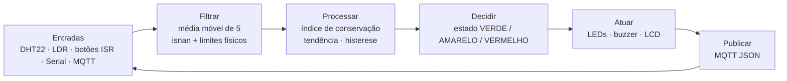

# 💊 IntegraMed v2.1 — Porta-Remédios Inteligente com Conservação Ambiental

> Global Solution FIAP 2026 (CitizenTech) · Edge Computing & Computer Systems

**Simulação no Wokwi:** `https://wokwi.com/projects/480863107384025089`
**Vídeo de apresentação:** ``
**Integrantes:** `Gustavo Bidin Marto 570272, Isadora Bradac 569585, Mateus Borges 571424, Artur de Sá 569526, Matheus Piorunneck 569454 `

---

## 1. Descrição do projeto

Muitos pacientes, principalmente idosos e pessoas em tratamento contínuo, esquecem horários de medicação ou guardam os remédios em condições inadequadas: calor, umidade e luz direta reduzem a eficácia de vários medicamentos.

O **IntegraMed** é um dispositivo IoT baseado em **ESP32** que resolve os dois problemas ao mesmo tempo:

1. **Lembra o paciente** de tomar o remédio no horário certo, com alerta visual e sonoro, e agenda sozinho a próxima dose conforme a posologia (8 em 8 h, 12 em 12 h etc.).
2. **Monitora a conservação** do medicamento (temperatura, umidade e exposição à luz) e alerta quando a caixa sai das condições ideais.

Todo o processamento acontece **na borda (Edge Computing)**: o ESP32 mede, filtra, decide e atua sozinho. A nuvem (broker MQTT) é usada para telemetria e para receber comandos remotos, e a decisão de alarme não depende dela.

### Novidades da v2.1

- **Botões por interrupção de hardware (ISR):** resposta instantânea, com debounce de 180 ms dentro da própria interrupção.
- **Feedback imediato:** ao confirmar uma dose ou cadastrar um remédio, o LCD mostra uma mensagem temporária e o buzzer emite um bip curto de confirmação.
- **Comandos pelo Monitor Serial**, além do MQTT, usando o mesmo interpretador de comandos.
- **Cadastro de receitas flexível:** texto delimitado (`,`, `;` ou `|`), JSON, comandos avulsos (`NOME`, `HORA`, `INT`) e perfis rápidos (`P1`, `P2`, `P3`).
- **Modo demonstração:** o comando `AGORA` dispara o alarme em 3 segundos.

## 2. Componentes utilizados

| Componente | Quantidade | Pino ESP32 | Função |
|---|---|---|---|
| ESP32 DevKit V1 | 1 | — | Microcontrolador (Wi-Fi + processamento na borda) |
| Sensor DHT22 | 1 | GPIO 15 | Temperatura e umidade da caixa |
| Sensor LDR (fotorresistor) | 1 | GPIO 34 (AO) | Luz: detecta a abertura da tampa |
| Botão verde | 1 | GPIO 4 | Confirma a dose ("Tomei o remédio") |
| Botão azul | 1 | GPIO 5 | Teste: avança o relógio para a próxima dose |
| LED verde | 1 | GPIO 12 | Estado 1: seguro |
| LED amarelo | 1 | GPIO 14 | Estado 2: alerta |
| LED vermelho | 1 | GPIO 27 | Estado 3: crítico |
| Resistores 220 Ω | 3 | — | Limitação de corrente dos LEDs |
| Buzzer | 1 | GPIO 26 | Alerta sonoro e bip de confirmação |
| LCD 16x2 I2C (0x27) | 1 | SDA 21 / SCL 22 | Relógio, temperatura, status e avisos |

**Bibliotecas:** `DHT sensor library`, `PubSubClient`, `LiquidCrystal I2C` (arquivo `libraries.txt`).

## 3. Lógica de funcionamento

### 3.1 Ciclo de borda



O loop principal usa **apenas `millis()`**, sem `delay()`, e segue esta ordem a cada iteração:

1. **Entradas imediatas:** consome as flags dos botões (setadas pelas ISRs) e lê comandos do Serial.
2. **Rede:** mantém Wi-Fi/MQTT com reconexão não-bloqueante (a cada 5 s) e executa `mqtt.loop()`.
3. **Relógio e sensores:** atualiza o relógio interno, lê o DHT22 a cada 2 s e detecta a abertura da tampa.
4. **Decisão e atuação:** verifica a agenda, decide o estado, atualiza LEDs, buzzer e LCD (a cada 500 ms ou imediatamente quando há aviso).
5. **Publicação:** envia a telemetria a cada 3 s ou na hora, quando o estado/alarme muda ou há um evento.

### 3.2 Botões por interrupção

Os dois botões usam `attachInterrupt(..., FALLING)` com `INPUT_PULLUP`. A rotina `IRAM_ATTR` apenas aplica o debounce (180 ms) e levanta uma flag `volatile`. O `loop()` consome a flag com `consumirBotao()` e executa a ação, sem precisar fazer polling dos pinos.

### 3.3 Os três estados operacionais

| Estado | Condição de entrada | LED | Buzzer |
|---|---|---|---|
| 🟢 **VERDE** (seguro) | Dose em dia, temperatura ≤ 25 °C, umidade ≤ 70 %, sem exposição à luz | Verde | Desligado |
| 🟡 **AMARELO** (alerta) | Hora da dose **ou** temperatura > 25 °C **ou** umidade > 70 % **ou** tampa aberta há 10 s ou mais sem dose pendente **ou** temperatura subindo ≥ 1 °C em 30 s (acima de 22 °C) | Amarelo | Bips periódicos |
| 🔴 **VERMELHO** (crítico) | Dose atrasada há mais de 15 s **ou** temperatura > 30 °C | Vermelho | Tom contínuo |

O campo `alarme` do JSON informa o motivo: `LEMBRETE`, `TERMICO`, `LUZ`, `TENDENCIA`, `CRITICO` ou `TERMICO_CRITICO`.

### 3.4 Processamento local

- **Média móvel (5 amostras)** para temperatura e umidade, suavizando o ruído do DHT22.
- **Validação robusta:** leituras com `isnan()` ou fora dos limites físicos são descartadas. O sistema mantém a última média e só declara o sensor indisponível após 5 falhas seguidas (o LCD mostra `--.-C`).
- **Histerese:** o amarelo entra em 25 °C (ou 70 % de umidade) e sai em 24 °C (e 68 %); o vermelho entra em 30 °C e sai em 29 °C. Isso evita LEDs piscando quando a medição oscila perto do limite.
- **Tendência:** compara a temperatura atual com a de ~30 s atrás (15 amostras de 2 s) e avisa antes de o limite ser cruzado.
- **Índice de Conservação (0–100 %):** penaliza calor, umidade e tempo de exposição à luz. Aparece no LCD e no JSON.
- **Detecção da tampa:** o LDR é lido no ADC (0–4095) e comparado a um limiar fixo (`LDR_LIMIAR = 2000`). A macro `LDR_ALTO_E_LUZ` define o sentido: `1` se mais luz significa valor maior, `0` no caso contrário. Se houver dose pendente, a abertura da tampa confirma a dose.

### 3.5 Relógio interno e posologia

O ESP32 mantém um relógio `HH:MM:SS` próprio, que avança 1 s a cada segundo real. Ele inicia às **07:59:45** para facilitar a demonstração, com a primeira dose agendada para as 08:00. Ao confirmar uma dose, o código soma o intervalo (em horas) ao horário programado e agenda a próxima. O contador de doses do dia zera na virada do dia.

### 3.6 Display LCD e feedback

- **Linha 1:** relógio e temperatura (`08:00:12 24.0C`).
- **Linha 2:** status atual: `Prox 16:00 C100%` (próxima dose e índice de conservação), `TOME O REMEDIO!`, `ATRASO CRITICO!`, `PERIGO TERMICO!`, `FECHE A TAMPA!`, `CAIXA ESQUENTANDO` ou `CAIXA QUENTE/UMIDA`.
- **Avisos temporários** (1,5 a 2,2 s) que ocupam as duas linhas e acompanham um bip curto de confirmação (1800 Hz):
  - `DOSE CONFIRMADA!` com a próxima dose;
  - `MODO DEMO` / `Alarme em 3s...`;
  - `REMEDIO ALTERADO`, `NOVO HORARIO` e `NOVO INTERVALO`;
  - nome do remédio e posologia (`08:00 a cada 8h`) ao cadastrar uma receita.

## 4. Comunicação MQTT

- **Broker:** `broker.hivemq.com`, porta `1883`, sem autenticação
- **Wi-Fi:** `Wokwi-GUEST`

| Tópico | Direção | Conteúdo |
|---|---|---|
| `fiap/gs2026/integramed/033/remedios` | ESP32 → app | Telemetria JSON (a cada 3 s e a cada mudança de estado/evento) |
| `fiap/gs2026/integramed/033/comandos` | app → ESP32 | Comandos remotos |
| `fiap/gs2026/integramed/033/status` | ESP32 → app | `online` / `offline` (Last Will, retido) |

**Exemplo de telemetria:**

```json
{"id":"integramed-033","relogio":"08:00:12","proxima_dose":"08:00","posologia":"8/8h",
 "remedio":"Dipirona 500mg","estado":"AMARELO","alarme":"LEMBRETE","tampa":"FECHADA",
 "doses_hoje":0,"temperatura":24.0,"umidade":40.0,"indice_conservacao":100,"tendencia":0.0}
```

> ⚠️ O broker `broker.hivemq.com` é **público**: qualquer pessoa que conheça os tópicos pode ver a telemetria e enviar comandos. Isso é aceitável para a simulação acadêmica. Em um produto real, seria necessário usar autenticação e TLS.

## 5. Comandos

Todos os comandos abaixo funcionam **tanto pelo MQTT** (tópico `.../comandos`) **quanto pelo Monitor Serial**, sem diferenciar maiúsculas de minúsculas. O Serial exibe a origem de cada comando no log (`[SERIAL]` ou `[MQTT]`).

### 5.1 Ações

| Comando | Efeito |
|---|---|
| `TOMAR`, `TOMEI` ou `OK` | Confirma a dose e agenda a próxima somando o intervalo |
| `PROXIMA`, `ALARME` ou `TESTE` | Avança o relógio para o horário da próxima dose (equivale ao botão azul) |
| `AGORA` ou `JA` | Modo demo: agenda o alarme para 3 s à frente |
| `STATUS` | Força a publicação imediata da telemetria |
| `AJUDA`, `HELP` ou `?` | Lista os comandos no Monitor Serial |

### 5.2 Cadastro de remédio

| Formato | Exemplo |
|---|---|
| Delimitado por `,`, `;` ou `\|` | `Amoxicilina 500mg, 08:00, 8` |
| Com prefixo opcional `RECEITA:`, `REMEDIO:` ou `CAD:` | `RECEITA:Amoxicilina 500mg\|08:00\|8` |
| JSON | `{"remedio":"Dipirona","hora":"08:00","intervalo":8}` |
| Campos avulsos | `NOME Dipirona`, `HORA 14:30`, `INT 8` (ou `INTERVALO 8`, ou só `8H`) |
| Atalho de horário | `14:30` |
| Perfis rápidos | `P1` Dipirona 500mg (08:00, 8 h) · `P2` Amoxicilina 500 (12:00, 8 h) · `P3` Losartana 50mg (07:00, 12 h) |

Regras de validação: horário entre `00:00` e `23:59`, intervalo entre 1 e 24 horas, nome não vazio (até 25 caracteres; aspas e barras invertidas são removidas para manter o JSON válido). Se o horário informado já passou hoje, a dose é agendada para amanhã.

## 6. Como executar a simulação

1. Abra o link do projeto no Wokwi (ou crie um projeto **ESP32** e copie `sketch.ino`, `diagram.json` e `libraries.txt`).
2. Clique em **▶ Start Simulation**.
3. Abra o **Monitor Serial** e confira `[MQTT] conectando... OK`. Digite `AJUDA` para ver os comandos.
4. (Opcional) No app **MyMQTT** (ou no HiveMQ Web Client), conecte em `broker.hivemq.com:1883`, assine `fiap/gs2026/integramed/033/#` e publique os comandos em `.../comandos`.

### Roteiro de teste

| # | Ação | Resultado esperado |
|---|---|---|
| 1 | Iniciar a simulação | LED verde, LCD com relógio, temperatura e `Prox 08:00 C100%` |
| 2 | Esperar o relógio chegar a 08:00:00 (ou digitar `AGORA`) | LED amarelo, bips e `TOME O REMEDIO!` |
| 3 | Pressionar o botão verde | Aviso `DOSE CONFIRMADA!` no LCD, bip curto, próxima dose às 16:00, volta ao verde |
| 4 | Pressionar o botão azul | Relógio vai a 16:00 e o amarelo acende |
| 5 | Não tomar por 15 s | LED vermelho e buzzer contínuo (`ATRASO CRITICO!`) |
| 6 | Com dose pendente, abrir a tampa (slider de luz do LDR) | Dose confirmada pela tampa |
| 7 | Subir a temperatura do DHT22 para 26 °C | Amarelo (`TERMICO`) |
| 8 | Subir a temperatura para 31 °C | Vermelho (`TERMICO_CRITICO`) |
| 9 | Baixar a temperatura para 23 °C | Volta ao verde (histerese) |
| 10 | Deixar a tampa aberta por 10 s sem dose pendente | Amarelo (`LUZ`, `FECHE A TAMPA!`) |
| 11 | Enviar `RECEITA:Amoxicilina 500mg\|08:00\|8` (MQTT ou Serial) | Aviso no LCD com o nome e a posologia, novo horário agendado |
| 12 | Enviar `P3` | Perfil Losartana 50mg carregado, próxima dose às 07:00 do dia seguinte |

> **LDR:** o limiar é fixo (`LDR_LIMIAR = 2000`, ADC de 0 a 4095). Se no seu circuito a abertura da tampa não for detectada, ajuste `LDR_LIMIAR` ou inverta o sentido com `LDR_ALTO_E_LUZ` no início do `sketch.ino`.

## 7. Estrutura do repositório

```
integramed/
├── sketch.ino       # código do ESP32 (comentado)
├── diagram.json     # circuito do Wokwi
├── libraries.txt    # bibliotecas
└── README.md
```

## 8. Desafios e soluções

| Desafio | Solução |
|---|---|
| Botões lentos ou perdendo aperto durante a rede/LCD | Interrupções de hardware (`IRAM_ATTR`) com flag `volatile` e debounce de 180 ms; o loop consome o evento |
| Paciente sem confirmação de que o aperto funcionou | Aviso temporário no LCD e bip curto de confirmação, preservado pelo controle do buzzer |
| Alarmes travando quando o broker demora | Loop não-bloqueante com `millis()`, reconexão a cada 5 s e `setSocketTimeout(2)` |
| Leituras ruins do DHT22 | Validação com `isnan()` e limites físicos, mais média móvel de 5 amostras |
| LED piscando perto do limite de 25 °C | Histerese nos limiares |
| Cadastrar remédios sem depender de um único formato | Interpretador único com formatos delimitado, JSON, campos avulsos e perfis rápidos, via MQTT e Serial |
| Demonstrar o alarme sem esperar o relógio | Comandos `AGORA` e `PROXIMA`, além do botão azul |
| Buzzer sem `tone()` compatível entre versões do core | API LEDC com compatibilidade para os cores 2.x e 3.x do Arduino-ESP32 |
| Queda de Wi-Fi ou do broker | Reconexão não-bloqueante e Last Will MQTT; o dispositivo continua operando na borda |
| Texto maior que o LCD 16x2 | Todas as linhas são truncadas e preenchidas em 16 caracteres (`%-16.16s`) |

---
*Projeto acadêmico desenvolvido para a Global Solution FIAP 2026.*
