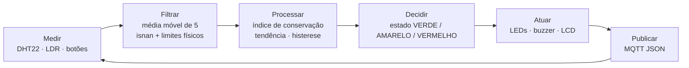

# 💊 IntegraMed — Porta-Remédios Inteligente com Conservação Ambiental

> Global Solution FIAP 2026 (CitizenTech) · Edge Computing & Computer Systems

**Simulação no Wokwi:** `[COLE AQUI O LINK PÚBLICO DO PROJETO]`
**Vídeo de apresentação:** `[COLE AQUI O LINK DO VÍDEO]`
**Integrantes:** `[NOMES E RMs]`

---

## 1. Descrição do projeto

Muitos pacientes, principalmente idosos e pessoas em tratamento contínuo, esquecem horários de medicação ou guardam os remédios em condições inadequadas: calor, umidade e luz direta reduzem a eficácia de vários medicamentos.

O **IntegraMed** é um dispositivo IoT baseado em **ESP32** que resolve os dois problemas ao mesmo tempo:

1. **Lembra o paciente** de tomar o remédio no horário certo, com alerta visual e sonoro, e agenda sozinho a próxima dose conforme a posologia (8 em 8 h, 12 em 12 h etc.).
2. **Monitora a conservação** do medicamento (temperatura, umidade e exposição à luz) e alerta quando a caixa sai das condições ideais.

Todo o processamento acontece **na borda (Edge Computing)**: o ESP32 mede, filtra, decide e atua sozinho. A nuvem (broker MQTT) é usada apenas para telemetria e para receber comandos remotos, e o dispositivo continua funcionando mesmo sem conexão.

## 2. Componentes utilizados

| Componente | Quantidade | Pino ESP32 | Função |
|---|---|---|---|
| ESP32 DevKit V1 | 1 | — | Microcontrolador (Wi-Fi + processamento na borda) |
| Sensor DHT22 | 1 | GPIO 15 | Temperatura e umidade da caixa |
| Sensor LDR (fotorresistor) | 1 | GPIO 34 (AO) | Luz: detecta a abertura da tampa |
| Botão verde | 1 | GPIO 4 | Confirma a dose ("Tomei o remédio") |
| Botão azul | 1 | GPIO 5 | Teste: avança o relógio para a próxima dose |
| LED verde | 1 | GPIO 12 | Estado 1: seguro |
| LED amarelo | 1 | GPIO 14 | Estado 2: alerta |
| LED vermelho | 1 | GPIO 27 | Estado 3: crítico |
| Resistores 220 Ω | 3 | — | Limitação de corrente dos LEDs |
| Buzzer | 1 | GPIO 26 | Alerta sonoro |
| LCD 16x2 I2C (0x27) | 1 | SDA 21 / SCL 22 | Relógio, temperatura, status e nome do remédio |

**Bibliotecas:** `DHT sensor library`, `PubSubClient`, `LiquidCrystal I2C` (arquivo `libraries.txt`).

## 3. Lógica de funcionamento

### 3.1 Ciclo de borda



O loop principal usa **apenas `millis()`**, sem `delay()`, e a rede roda em uma **tarefa FreeRTOS separada**:

| Núcleo | Responsabilidade |
|---|---|
| **Núcleo 1 (loop)** | Borda: sensores, decisão, LEDs, buzzer, LCD e botões. Nunca espera pela rede. |
| **Núcleo 0 (tarefa de rede)** | Wi-Fi e MQTT. Se o broker demorar ou cair, a borda continua funcionando. |

A comunicação entre os dois núcleos é segura: os comandos recebidos pelo MQTT entram em uma **fila** e são executados pela borda. A telemetria é entregue por um buffer protegido por **mutex**.

### 3.2 Os três estados operacionais

| Estado | Condição de entrada | LED | Buzzer |
|---|---|---|---|
| 🟢 **VERDE** (seguro) | Dose em dia, temperatura ≤ 25 °C, umidade ≤ 70 %, sem exposição à luz | Verde | Desligado |
| 🟡 **AMARELO** (alerta) | Hora da dose **ou** temperatura > 25 °C **ou** umidade > 70 % **ou** tampa aberta há mais de 10 s sem dose **ou** temperatura subindo ≥ 1 °C em 30 s | Amarelo | Bips periódicos |
| 🔴 **VERMELHO** (crítico) | Dose atrasada há mais de 15 s **ou** temperatura > 30 °C | Vermelho | Tom contínuo |

O campo `alarme` do JSON informa o motivo: `LEMBRETE`, `TERMICO`, `LUZ`, `TENDENCIA`, `CRITICO` ou `TERMICO_CRITICO`.

### 3.3 Processamento local

- **Média móvel (5 amostras)** para temperatura e umidade, suavizando o ruído do DHT22.
- **Validação robusta:** leituras com `isnan()` ou fora dos limites físicos são descartadas. O sistema mantém a última média e só declara o sensor indisponível após 5 falhas seguidas (o LCD mostra `--.-C`).
- **Histerese:** o amarelo entra em 25 °C e sai em 24 °C, e o vermelho entra em 30 °C e sai em 29 °C. Isso evita LEDs piscando quando a temperatura oscila perto do limite.
- **Tendência:** compara a temperatura atual com a de ~30 s atrás e avisa antes de o limite ser cruzado.
- **Índice de Conservação (0–100 %):** penaliza calor, umidade e tempo de exposição à luz. Aparece no LCD e no JSON.
- **Detecção da tampa com calibração automática:** no boot, o LDR é calibrado (média de 16 leituras com a tampa fechada). A tampa é considerada aberta quando a leitura se afasta dessa base, com histerese. Se houver uma dose pendente, a abertura confirma a dose.

### 3.4 Relógio interno e posologia

O ESP32 mantém um relógio `HH:MM:SS` próprio, que avança 1 s a cada segundo real. Ele inicia às **07:59:45** para facilitar a demonstração. Ao confirmar uma dose, o código soma o intervalo (em horas) ao horário programado e agenda a próxima dose. A confirmação só vale quando **há uma dose pendente**, então um aperto acidental do botão não desloca a agenda. O contador de doses do dia zera na virada do dia.

### 3.5 Display LCD

- **Linha 1:** relógio e temperatura (`08:00:12 24.0C`).
- **Linha 2:** alterna a cada 3 s entre o status (`Prox 16:00 C100%`, `TOME O REMEDIO!`, `FECHE A TAMPA!`...) e o **nome do remédio**. Nomes com mais de 16 caracteres rolam pela tela.

## 4. Comunicação MQTT

- **Broker:** `broker.hivemq.com`, porta `1883`, sem autenticação
- **Wi-Fi:** `Wokwi-GUEST`

| Tópico | Direção | Conteúdo |
|---|---|---|
| `fiap/gs2026/integramed/033/remedios` | ESP32 → app | Telemetria JSON (a cada 3 s e a cada mudança de estado) |
| `fiap/gs2026/integramed/033/comandos` | app → ESP32 | Comandos remotos |
| `fiap/gs2026/integramed/033/status` | ESP32 → app | `online` / `offline` (Last Will, retido) |

**Exemplo de telemetria:**

```json
{"id":"integramed-033","relogio":"08:00:12","proxima_dose":"08:00","posologia":"8/8h",
 "remedio":"Dipirona 500mg","estado":"AMARELO","alarme":"LEMBRETE","tampa":"FECHADA",
 "doses_hoje":0,"temperatura":24.0,"umidade":40.0,"indice_conservacao":100,"tendencia":0.0}
```

> ⚠️ O broker `broker.hivemq.com` é **público**: qualquer pessoa que conheça os tópicos pode ver a telemetria e enviar comandos. Isso é aceitável para a simulação acadêmica. Em um produto real, seria necessário usar autenticação e TLS.

**Comandos aceitos:**

| Comando | Efeito |
|---|---|
| `TOMAR` ou `TOMEI` | Confirma a dose pendente e agenda a próxima somando o intervalo (ignorado se não houver dose pendente) |
| `PROXIMA` ou `ALARME` | Avança o relógio para o horário da próxima dose (teste) |
| `RECEITA:Nome\|HH:MM\|Horas` | Cadastra novo remédio, primeiro horário e posologia. Ex.: `RECEITA:Amoxicilina 500mg\|08:00\|8` |
| `HH:MM` | Agenda a próxima dose para um horário específico. Ex.: `14:30` |
| `STATUS` | Força a publicação imediata da telemetria |
| `AJUDA` | Lista os comandos no Monitor Serial |

## 5. Como executar a simulação

1. Abra o link do projeto no Wokwi (ou crie um projeto **ESP32** e copie `sketch.ino`, `diagram.json` e `libraries.txt`).
2. Clique em **▶ Start Simulation**.
3. Abra o **Monitor Serial** e confira `[MQTT] conectando... OK`.
4. (Opcional) No app **MyMQTT** (ou no HiveMQ Web Client), conecte em `broker.hivemq.com:1883`, assine `fiap/gs2026/integramed/033/#` e publique os comandos em `.../comandos`.

### Roteiro de teste

| # | Ação | Resultado esperado |
|---|---|---|
| 1 | Iniciar a simulação | LED verde, LCD com relógio e nome do remédio |
| 2 | Esperar o relógio chegar a 08:00:00 | LED amarelo, bips e `TOME O REMEDIO!` |
| 3 | Pressionar o botão verde | Dose confirmada, próxima às 16:00, volta ao verde (se não houver dose pendente, o aperto é ignorado) |
| 4 | Pressionar o botão azul | Relógio vai a 16:00 e o amarelo acende |
| 5 | Não tomar por 15 s | LED vermelho e buzzer contínuo |
| 6 | Reiniciar o ciclo e abrir a tampa (slider de luz do LDR) com dose pendente | Dose confirmada pela tampa |
| 7 | Subir a temperatura do DHT22 para 26 °C | Amarelo (`TERMICO`) |
| 8 | Subir a temperatura para 31 °C | Vermelho (`TERMICO_CRITICO`) |
| 9 | Baixar a temperatura para 23 °C | Volta ao verde (histerese) |
| 10 | Deixar a tampa aberta por mais de 10 s sem dose pendente | Amarelo (`LUZ`) |
| 11 | Publicar `RECEITA:Amoxicilina 500mg\|08:00\|8` | Novo nome rolando no LCD e novo horário agendado |

> **LDR:** o sensor é calibrado quando a simulação inicia. **Comece a simulação com o slider de luz no valor normal (tampa fechada)** e depois mude o valor para simular a abertura. Se a abertura não for detectada, reduza `LDR_DELTA_ABRIR` no início do `sketch.ino`.

## 6. Estrutura do repositório

```
integramed/
├── sketch.ino       # código do ESP32 (comentado)
├── diagram.json     # circuito do Wokwi
├── libraries.txt    # bibliotecas
└── README.md
```

## 7. Desafios e soluções

| Desafio | Solução |
|---|---|
| Alarmes e botões travando quando o broker demora | Rede isolada em uma tarefa FreeRTOS no núcleo 0, com fila de comandos e mutex; o loop da borda usa só `millis()` |
| Leituras ruins do DHT22 | Validação com `isnan()` e limites físicos, mais média móvel de 5 amostras |
| LED piscando perto do limite de 25 °C | Histerese nos limiares |
| Aperto acidental do botão deslocando a agenda | Confirmação aceita somente com dose pendente |
| Posição e polaridade do LDR variam no simulador | Calibração automática no boot e detecção por diferença, nos dois sentidos |
| Buzzer sem `tone()` compatível entre versões do core | API LEDC com compatibilidade para os cores 2.x e 3.x do Arduino-ESP32 |
| Queda de Wi-Fi ou do broker | Reconexão não-bloqueante e Last Will MQTT; o dispositivo continua operando na borda |
| Mostrar nomes longos em um LCD 16x2 | Alternância entre status e nome, com rolagem |

---
*Projeto acadêmico desenvolvido para a Global Solution FIAP 2026.*
